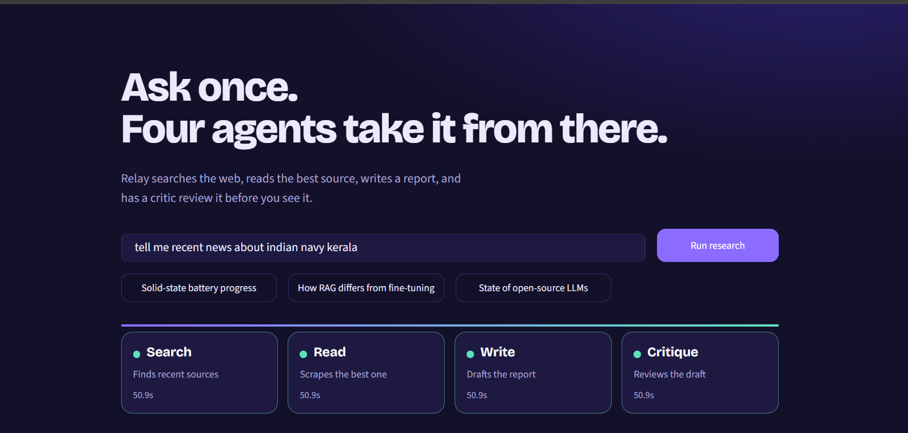
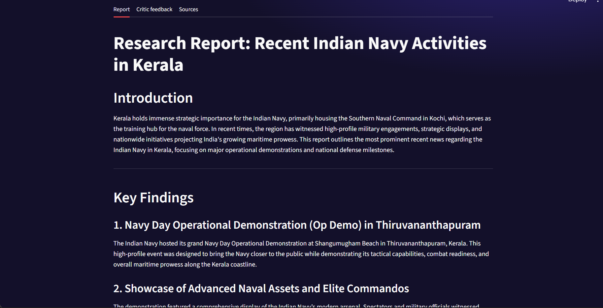
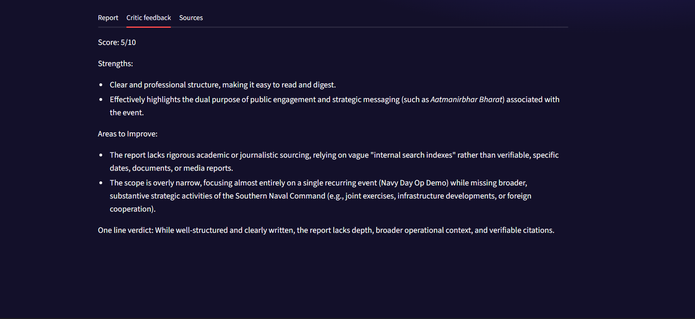
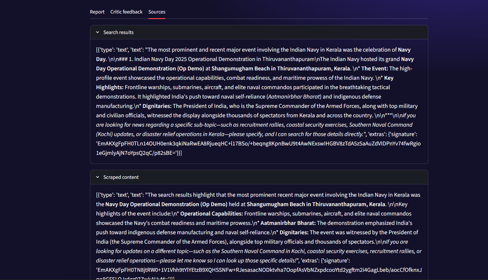

## LangChain concepts to revisit

### Agents and tools

An agent combines a language model with tools. The model decides whether it needs a tool, what input to give it, and whether it needs another model turn after seeing the tool result.

- `build_search_agent()` creates an agent that can use `web_search`.
- `build_reader_agent()` creates an agent that can use `scrape_url`.
- The `@tool` decorator exposes `web_search` to LangChain as a tool with a name, description, and input schema.
- `invoke()` runs an agent. The returned `messages` include the interaction; this project takes the final message as that stage's result.

### Chains and LCEL

The writer and critic use LangChain Expression Language (LCEL), where the pipe operator passes each result into the next component:

```python
prompt | llm | StrOutputParser()
```

The prompt formats the inputs, the model generates a response, and `StrOutputParser` returns the response as a string.

### Orchestration and shared state

`run_research_pipeline()` is the coordinator. It invokes the search agent, stores its result, passes research to the reader, combines the search and reading results for the writer, then sends the report to the critic.

The returned dictionary contains:

| Key | Value |
| --- | --- |
| `search_result` | Text returned by the search agent |
| `reader_result` | Text returned by the reader agent |
| `report` | Draft research report |
| `feedback` | Critic's review of the report |

This simple dictionary is useful for learning how data moves through a pipeline. A larger application might use a validated state model or a dedicated workflow graph.

## Observability notes

The pipeline uses Python's `logging` module for timestamped messages. `PipelineDebugHandler` logs model and tool lifecycle events without logging their full inputs or outputs. `run_step()` wraps each pipeline stage, shows a Rich status indicator in the terminal, records how long the stage took, logs exceptions, and re-raises failures.

The Streamlit app has an overall running/completed/error status. The Rich terminal spinner is not the Streamlit progress display. Per-stage updates inside the Streamlit page can be added by passing progress events from the pipeline to the UI.

## Setup

Use Python 3.11 or a compatible version supported by the pinned dependencies.

1. Create and activate a virtual environment:

   ```powershell
   py -m venv .venv
   .\.venv\Scripts\Activate.ps1
   ```

2. Install dependencies:

   ```powershell
   python -m pip install -r requirements.txt
   ```

3. Create a `.env` file in the project root:

   ```dotenv
   GOOGLE_API_KEY=your_google_gemini_api_key
   TAVILY_API_KEY=your_tavily_api_key
   ```

   Keep `.env` private and do not commit it. The repository's `.gitignore` should exclude it.

4. Run the Streamlit interface:

   ```powershell
   streamlit run app.py
   ```

   Or run the command-line pipeline:

   ```powershell
   python pipeline.py
   ```

## Configuration

- The Gemini model and model options are configured in `agents.py`.
- API keys are loaded from environment variables by `python-dotenv`.
- Tavily search behavior and URL fetching are implemented in `tool.py`.
- Dependency versions are listed in `requirements.txt`.

## Learning notes and next improvements

- Model calls are sequential, so total run time includes the time for multiple model requests and tool calls.
- Search agents may make multiple searches. The callback logs help distinguish model calls from tool calls.
- Web search results and scraped pages are external, untrusted content. The report should be checked against its sources.
- Add tests with mocked model and tool calls so pipeline behavior can be checked without live API requests.
- Add explicit request timeouts, input validation, and user-facing handling for provider and network errors.
- Restrict URLs before scraping; a production scraper should block local/private network addresses and limit redirects and response size.
- Keep API keys out of source code and logs. For deployed applications, use the hosting platform's secret manager.
- Add rate limits and usage controls before exposing the app to multiple users.

## Screenshots

Add your screenshots under `screenshots/` and use these four slots to document the interface and output.

### 1. Research topic input



### 2. generate report



### 3. Critic feedback and research trail



### 4. sources


